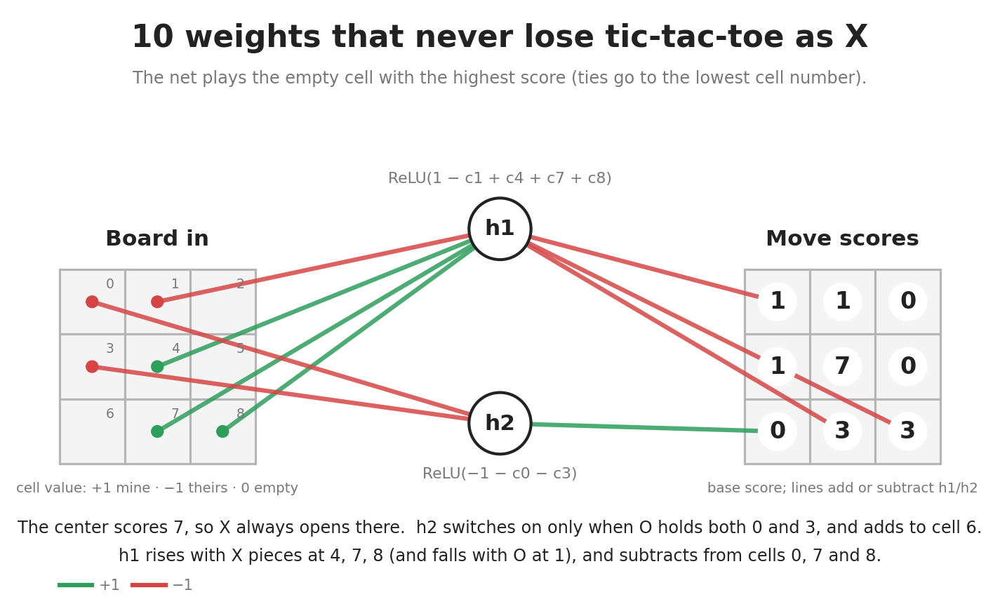

# Tic-tac-toe ternary networks

## Overview

This folder contains neural networks that play tic-tac-toe with small integer biases and integer arithmetic throughout, together with the code that trained them, searched for them and verified them. Each network has one hidden layer and chooses a move with one forward pass and no search. Each network is named here by its total number of parameters, every weight slot and every bias, followed by its number of nonzero weights. Two results are reported side by side, because a fixed symmetry step in front of the network changes the answer. Without it, the smallest network we found that never loses as either X or O is a 560-parameter ternary model (every weight is −1, 0 or +1) with 29 hidden units and 186 nonzero weights. With the board first replaced by the smallest of its 8 rotations and reflections, the smallest we found is an 85-parameter ternary model with 4 hidden units and 39 nonzero weights. The symmetry step does much of the work: with it, 146 of the 362,880 fixed cell orders, which use no weights at all, already never lose as X, and without it none does. The larger 275-, 332- and 457-parameter ternary models (141, 204 and 286 nonzero weights) also take every immediate win, keep every won position won, and play optimally in all 4,520 positions with a move to make, respectively. A 47-parameter ternary model, with 2 hidden units and 10 nonzero weights, never loses when it plays tic-tac-toe as X and loses as O.

Two different guarantees are checked, and they should not be confused. "Never loses" is on-policy safety: from the empty board, as X and as O, no sequence of opponent replies leads to a loss, but positions that the network's own moves never lead to are not tested. "Optimal" is global optimality: the move keeps the minimax value in every one of the 4,520 positions with a move to make. The smallest networks are on-policy safe and far from optimal; the 85-parameter ternary model plays a value-keeping move in 3,376 of the 4,520 positions.

Every guarantee was checked exhaustively. For the never-lose property each network was played from the empty board against every possible sequence of opponent replies, once as X and once as O. For the stronger properties each network's move was evaluated in all 4,520 positions and compared with exact minimax values.

To our knowledge, these are the smallest neural networks verified over the full game tree never to lose tic-tac-toe from the start of a game as either X or O, with no search at play time: a 123-parameter ternary model (6 hidden units, 67 nonzero weights) without the symmetry step described below, and an 85-parameter ternary model (4 hidden units, 39 nonzero weights) with it, both given a mask that allows only empty cells and the lowest-index tie rule. All sizes are the smallest found, not proven minima. The only other network we know of that has been checked over the full game tree was set by hand and has 15,781 parameters (Garrido-Merchán, 2026, arXiv 2611.09271). We also know of no learned model, of any size, verified over every position to take every immediate win, keep every won position won or play optimally everywhere. We have not proved that no smaller network exists, and the Lower bounds section states what has been proved.

The never-lose property holds from the start of a game. A network placed in a position that it would never reach by its own play can lose. The symmetry step, the legal-move mask and the tie rule are fixed code with no parameters and are not included in any parameter count. Their cost per move is counted separately in `results/cost.json` (`cost.py`): the symmetry step computes 7 board images and needs 13.2 cell comparisons on average and 63 at most, the mask is 9 emptiness tests, and the tie rule is at most 8 score comparisons, against 50 additions and 4 ReLUs for the 85-parameter ternary model itself.

The networks can be played in a browser by opening [page/index.html](page/index.html), which runs offline and carries the 47-, 85-, 275-, 332- and 457-parameter ternary models.

## Networks

Every file in `weights/` records its own exhaustive check under `"verified"`, and `tests/test_ttt.py` repeats it. In that record the key `perfect` means "never loses as X and as O from the empty board" and nothing more. Game lines are given as wins, draws and losses for the network over every opponent line from the empty board.

| file | plays | input | hidden | params | nonzero weights | as X | as O | level |
|---|---|---|---|---|---|---|---|---|
| `weights/smallest-never-loses-h4.json` | X and O | 9 trits, symmetry | 4 | 85 | 39 | 120/32/0 | 380/215/0 | never loses |
| `weights/smallest-never-loses-h5.json` | X and O | 9 trits, symmetry | 5 | 104 | 46 | 184/52/0 | 353/430/0 | never loses |
| `weights/smallest-sat-xo.json` | X and O | 9 trits, symmetry | 5 | 104 | 46 | 184/52/0 | 353/430/0 | never loses (same network as the line above, the page's copy) |
| `weights/smallest-never-loses.json` | X and O | 9 trits, symmetry | 10 | 199 | 63 | 128/28/0 | 334/293/0 | never loses (trained) |
| `weights/smallest-never-loses-params.json` | X and O | 9 trits, symmetry | 9 | 180 | 73 | 191/48/0 | 375/286/0 | never loses (trained) |
| `weights/smallest-never-loses-step.json` | X and O | 18 planes, symmetry | 15 | 429 | 114 | 192/44/0 | 438/275/0 | never loses, binary hidden units |
| `weights/smallest-finisher.json` | X and O | 9 trits, symmetry | 14 | 275 | 141 | 72/4/0 | 378/79/0 | also takes every immediate win |
| `weights/smallest-converter.json` | X and O | 9 trits, symmetry | 17 | 332 | 204 | 72/4/0 | 362/95/0 | also keeps every won position won |
| `weights/smallest-optimal.json` | X and O | 18 planes, symmetry | 16 | 457 | 286 | 108/4/0 | 404/111/0 | optimal in all 4,520 positions |
| `weights/smallest-optimal-trits.json` | X and O | 9 trits, symmetry | 20 | 389 | 233 | 120/4/0 | 448/95/0 | optimal in all 4,520 positions |
| `weights/smallest-never-loses-nosym-sat.json` | X and O | 9 trits | 6 | 123 | 67 | 198/72/0 | 378/443/0 | never loses, no symmetry step (SAT search, pruned) |
| `weights/smallest-never-loses-nosym-sat-h7.json` | X and O | 9 trits | 7 | 142 | 64 | 121/46/0 | 386/391/0 | never loses, no symmetry step (SAT search, pruned) |
| `weights/smallest-never-loses-nosym.json` | X and O | 9 trits | 29 | 560 | 186 | 111/33/0 | 353/230/0 | never loses, no symmetry step (trained) |
| `weights/smallest-optimal-nosym.json` | X and O | 9 trits | 123 | 2346 | 1340 | 107/2/0 | 449/114/0 | optimal, no symmetry step |
| `weights/smallest-x-only.json` | X only | 9 trits | 2 | 47 | 10 | 109/38/0 | 240/232/197 | never loses as X |
| `weights/xonly-raw-H1.json` | X only | 9 trits | 1 | 28 | 11 | 103/20/0 | 393/102/178 | never loses as X |
| `weights/xonly-raw-trained.json` | X only | 9 trits | 2 | 47 | 11 | 157/46/0 | 332/242/117 | never loses as X (trained) |
| `weights/xonly-sym-bias-only.json` | X only | 9 trits, symmetry | 1 | 28 | 0 | 156/48/0 | 331/34/462 | never loses as X, biases only |

The never-losing networks do not always take a win when one is available, because a draw also passes the never-lose check. The 85-parameter ternary model takes an immediate win in 1,454 of the 2,358 positions that offer one. The finisher, converter and optimal networks remove that shortfall at increasing size. With the symmetry step an X-only player needs no nonzero weights at all, as the last row shows, because the symmetry step by itself supplies most of a strategy for X. For that reason the X-only comparison that matters is the 47-parameter ternary model with 10 nonzero weights, which has no symmetry step.



## How a network plays

```
x = the board relative to the side to move      trits: +1 mine, -1 theirs, 0 empty (planes: 18 inputs in {0, 1})
if symmetry: x = the smallest of its 8 images   (the chosen cell is mapped back afterwards)
h = relu(W1 x + b1)                             W in {-1, 0, +1}, b integers
z = W2 h + b2
move = the empty cell with the largest z, lowest index on ties
```

The input is the board seen from the side to move, so one network plays both sides. With the `trits` encoding each cell is one input, +1 for the mover's piece, −1 for the opponent's and 0 for an empty cell. With the `planes` encoding there are 18 inputs, 9 marking the mover's pieces and 9 marking the opponent's. When the symmetry step is on, the board is replaced by the smallest of its 8 rotations and reflections, compared cell by cell with empty as 0, X as 1 and O as 2, before the network sees it, and the chosen cell is mapped back afterwards. Ties go to the lowest cell index, counted in the rotated frame when the symmetry step is on, with cells numbered 0 to 8 row by row from the top left.

Every per-layer scale is 1, so the integer network is the complete model and nothing is rounded at export. `net.py` is the reference implementation and uses only the standard library, and the page's JavaScript is checked against it in every position.

The weight files use this format:

```json
{"format": "ttt-ternary-mlp-v1", "encoding": "trits", "symmetry": true, "act": "relu",
 "layers": [{"W": [[-1, 0, 1, ...], ...], "b": [0, ...]}, {"W": ..., "b": ...}], "scales": [1.0, 1.0]}
```

## Quick start

The code needs Python 3.10 or newer.

```sh
git clone https://github.com/Milliwatt-Labs/tiny-games
cd tiny-games/tictactoe
python3 -m pip install -r requirements.txt
python3 -m pytest tests -q
python3 verify.py weights/smallest-never-loses-h4.json          # exit 0 if the network never loses as X or O
python3 verify.py weights/smallest-never-loses-h4.json --play   # you play X; --o to play O; cells 1-9
```

The page test needs Node on the PATH and the GPU player's test needs a C++ compiler, and each is skipped when its tool is missing. The solver tests are skipped without python-sat.

## Method

The networks were found in two ways. The first was quantisation-aware training on all positions (`train.py`, `sweep.py`, `report.py`). In the forward pass the weights are rounded to −1, 0 or +1 and the biases to integers, gradients pass through the rounding unchanged, and the loss rewards placing probability on the set of optimal moves. Training was followed by a discrete repair step, a hill climb over single weights and biases that removes the remaining losing moves, and then by greedy pruning of hidden units, weights and biases that keeps the guarantee intact. This produced the 199-, 180-, 275-, 332- and 457-parameter ternary models (63, 73, 141, 204 and 286 nonzero weights).

The second was an exact search (`minsat.py`, `satnet.py`). The question of whether a never-losing network with H hidden units exists is written as a Boolean satisfiability problem and solved with CaDiCaL through python-sat. The search starts from the opening positions and adds a position as a counterexample whenever a candidate network fails the full game-tree check, and every network it returns is checked again by `net.verify`. It found never-losing networks with 4, 5 and 6 hidden units, and pruning then reduced them to the 85-parameter ternary model with 39 nonzero weights at width 4 and the 104-parameter ternary model with 46 nonzero weights at width 5.

```sh
python3 -m pip install -r requirements-train.txt
python3 train.py --hidden 12 --symmetry --encoding trits --prune never-loses    # one run
python3 sweep.py --jobs 6 --nets nets                                       # the size sweep, hours of CPU
python3 report.py --nets nets --squeeze 24 > results/tables.md

python3 -m pip install -r requirements-sat.txt                              # optional
python3 minsat.py --hidden 5 --sym --sides xo                               # minutes; prints the network it finds
```

The full numbers, method and sources are in [results/REPORT.md](results/REPORT.md).

## Lower bounds

The exact search gives lower bounds for this model class, which is one hidden layer, weights of −1, 0 or +1, integer biases, ReLU, the trits encoding and the lowest-index tie rule. With the symmetry step, a network of width 1 cannot avoid losing for any integer biases; the CaDiCaL LRAT proof was checked by lrat-check and by cake_lpr, a checker whose algorithm is formally verified in CakeML, and a kissat DRAT proof of the same CNF by drat-trim. Without the symmetry step, width 1 is also impossible for any integer biases, with an LRAT proof checked the same two ways. With the symmetry step, a network of width 2 cannot avoid losing when the first-layer biases lie in [−3, 3] and the output biases span at most 12; see `results/certificates.json` for the state of its proof. The proof for unrestricted biases at width 2 and the cube-and-conquer proof at width 3 are running. Width 4 is enough, as the 85-parameter ternary model with 39 nonzero weights shows.

`results/certificates.json` lists, for every UNSAT result, the SHA-256 of the exact CNF file, the solver with its version and flags, the proof's SHA-256 and size, and each checker run with its result. The proofs themselves are too large for the repository; each CNF is rebuilt byte for byte by `cnfproof.py build`, and each proof can be produced again by running the listed solver command. A proof checker certifies that the CNF file is unsatisfiable. That the CNF says what is claimed is tested separately: `tests/test_encoding_audit.py` decodes every SAT model the search found and checks it with `net.verify`, reads the move each CNF encodes in every position for random networks and compares it with a direct simulation of the move rule, including ties and the legal mask, and checks that the CNF accepts a pinned network or a random assignment of its variables exactly when the verifier says the decoded network never loses.

We therefore do not claim that the 85-parameter ternary model is the smallest possible, and no minimum number of nonzero weights has been proved for any width. `cnfproof.py` writes the question as a DIMACS file that any solver and proof checker can read, and `proof_chain.sh` runs the width-3 proof. The docstrings describe the external solvers they use.

## Game-play check

The guarantees come from the exhaustive verifier. The GPU run is a stress test of a second implementation of the players, a CUDA kernel, and adds nothing to them. Three networks played 2,590,000,000,000 complete games on one GPU against optimal, random and partly random opponents, and none of those games was lost. Because the networks are deterministic, those games covered only 2,391 of the 255,168 possible complete games. The networks were the finisher, a 275-parameter ternary model, and the 104-parameter ternary model, each as X and as O, and the 47-parameter ternary model as X. The 85-parameter ternary model was found after this run and did not take part. Games that start from random opening moves lie outside the guarantee and are reported separately, and from those openings the networks can lose. The details are in [results/humanity.md](results/humanity.md).

```sh
python3 humanity/humanity.py check        # CPU build of the GPU player, checked against net.py (needs c++)
python3 humanity/humanity.py bench        # needs CUDA (nvcc); NVCC=/path/to/nvcc to override
nohup python3 humanity/humanity.py supervise > supervise.log 2>&1 &    # the full run, checkpointed
python3 humanity/humanity.py status
python3 humanity/humanity.py report humanity-run/results.json --out results/humanity.md
```

## Files

| file | contents |
|---|---|
| `game.py` | rules, exact minimax over all 5,478 legal positions, optimal moves, the 8 symmetries, encodings |
| `net.py` | weight format, integer reference forward pass, exhaustive verification |
| `verify.py` | checks one network, or plays it in the terminal |
| `train.py`, `sweep.py`, `report.py` | training, the size sweep, and selecting and pruning the smallest networks |
| `priority.py` | bias-only players: all 9! fixed cell orders |
| `cost.py` | per-move cost of the symmetry step, mask and tie rule, and the network's additions |
| `minsat.py`, `satnet.py` | the exact search (SAT with CaDiCaL via python-sat; CP-SAT for cross-checks) |
| `prove.py`, `minsat_table.py` | a local job queue for `minsat.py` runs, and their results table |
| `cnfproof.py`, `proof_chain.sh` | DIMACS export, external solvers with DRAT/LRAT proofs, cube-and-conquer |
| `humanity/` | the GPU game player (`ttt_gpu.cu`, which also builds for CPU) and its driver |
| `page/` | the playable page, built by `page_build.py` from `template.html` and `copy.json` |
| `tests/` | exhaustive checks of every network, page parity in Node, solver encoder checks and the encoding audit (`test_encoding_audit.py`, with the SAT models in `tests/sat-models/`) |
| `results/` | report, tables, solver and game-play data, figure |

## Licence

The code is licensed under MIT ([../LICENSE](../LICENSE)). The weights, results data and figures, this model card and the accompanying paper are licensed under CC BY 4.0 ([../LICENSE-WEIGHTS](../LICENSE-WEIGHTS)), with the attribution "Tic-tac-toe nets by Milliwatt Labs (milliwattlabs.com)".
